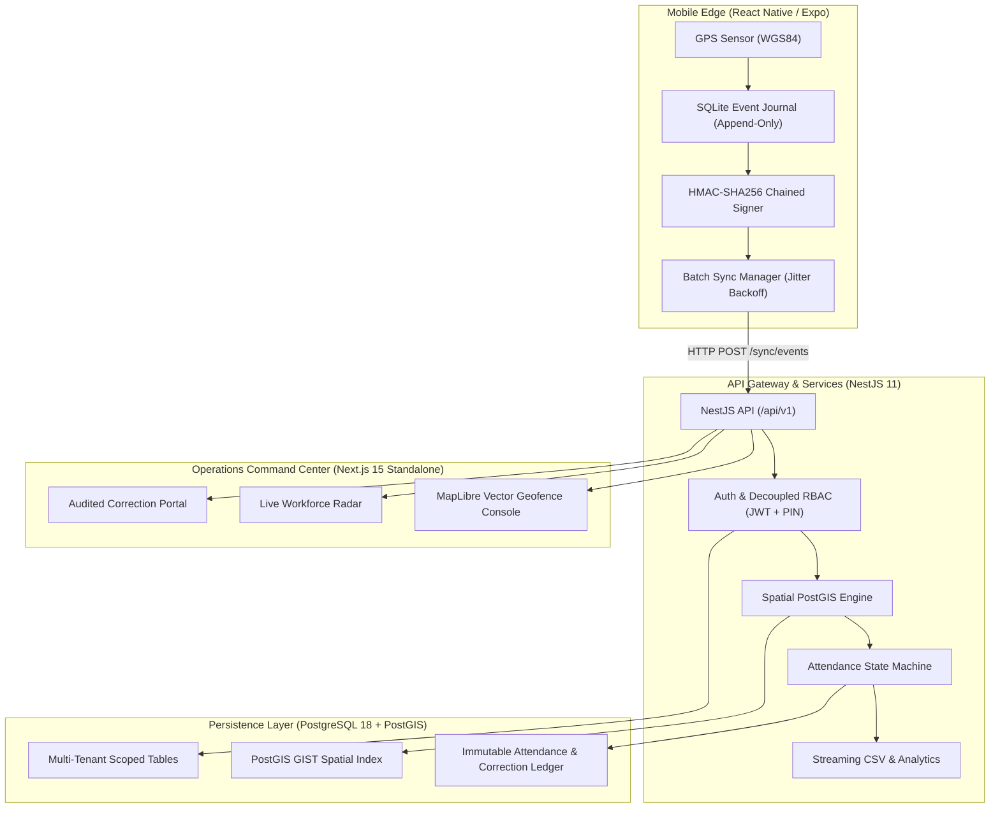
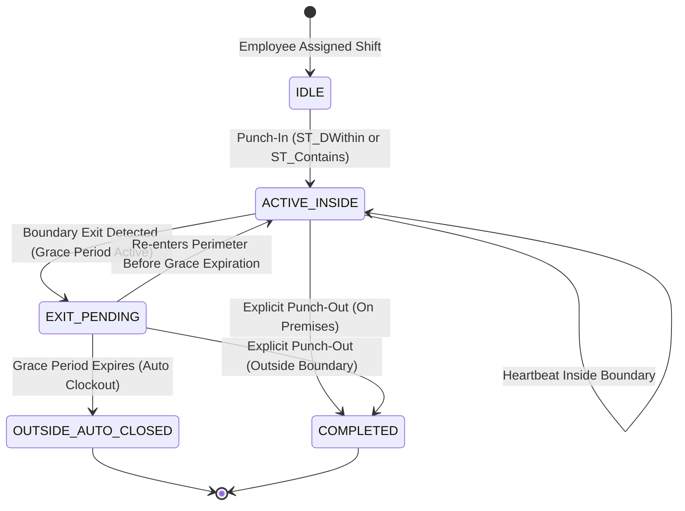
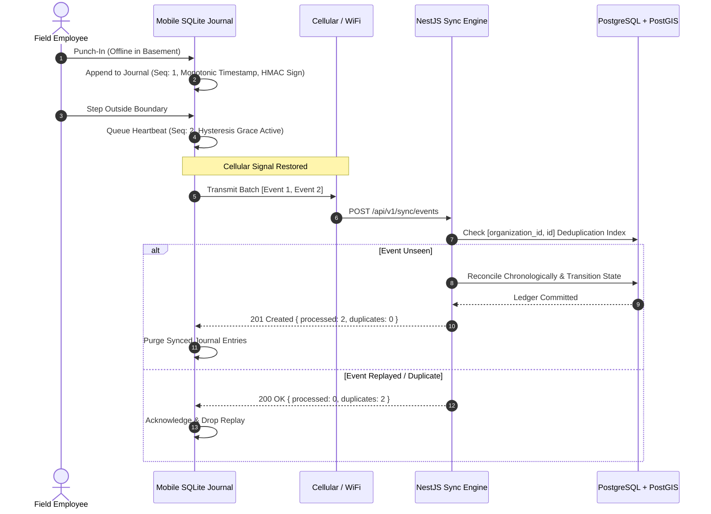

# GeoTrack Enterprise — Geospatial Workforce & Automated Attendance Engine

[](https://nextjs.org/)
[](https://react.dev/)
[](https://nestjs.com/)
[](https://www.postgresql.org/)
[](https://postgis.net/)
[](https://www.docker.com/)
[](https://github.com/Vikash7t/employee-tracking/actions)
[](https://www.typescriptlang.org/)
[](LICENSE)

> **Enterprise-grade, offline-first geospatial workforce tracking and automated attendance verification platform.** Built with PostGIS geodesic spatial queries on the WGS 84 ellipsoid, client-side SQLite append-only event journals, crash-resilient exit hysteresis grace periods, overnight shift orchestration, and audited CSV reporting protected against CWE-1236 injection attacks.

---

## ⚡ 2-Minute Recruiter Executive Summary

GeoTrack solves the three fatal flaws common in traditional workforce tracking apps:
1. **GPS Jitter & False Breaches:** Rather than naive flat-Earth Haversine math, GeoTrack runs PostGIS geodesic queries on the true WGS84 spheroid with 3-zone sensor accuracy dampening ($E_{\text{acc}} \le 50\text{m}$) and a configurable hysteresis grace period (120s–300s) preventing false-exit flapping near perimeter boundaries.
2. **Offline Field Realities:** When mobile workers enter basements or remote work sites with zero cellular coverage, an append-only SQLite journal cryptographically chains events with HMAC-SHA256 signatures. Upon reconnection, an idempotent bulk ingestion engine reconciles late-arriving punches with zero data loss or duplicate sessions.
3. **Enterprise Compliance & Auditing:** Midnight-crossing shift calculation (22:00–06:00), immutable manager timesheet correction ledgers, streaming CSV exports with formula injection neutralization (CWE-1236), unprivileged Docker containers (CIS benchmark), and request correlation tracing (CWE-117).

---

## 🏛️ System Architecture



---

## 🔄 Geospatial Presence & Hysteresis State Machine

To eliminate boundary "flapping" when GPS accuracy fluctuates near geofences, GeoTrack implements a state machine with a temporal hysteresis buffer:



---

## 📡 Offline Event Journal & Batch Sync Flow



---

## 🛡️ Enterprise Security & OWASP Top 10 Mitigations

| Threat Vector | CWE / OWASP | Implemented Mitigation | Verification Suite |
| :--- | :--- | :--- | :--- |
| **Formula Injection** | CWE-1236 / CSV Injection | Prepend `'` prefix to any string starting with `=`, `+`, `-`, `@`, `\t`, `\r` during streaming CSV export. | `verify-phase9-reports.js` |
| **Log Injection** | CWE-117 / CRLF Injection | Custom `X-Correlation-ID` middleware strips newline/carriage characters before logger consumption. | `verify-phase10-hardening.js` |
| **Broken Object Level Auth** | OWASP API 1 (BOLA) | Every database query and spatial evaluation is strictly scoped by `organizationId` from authenticated JWT claims. | `verify-phase2.js` |
| **Container Privilege Escalation** | CIS Docker Benchmark | Multi-stage Docker build running under unprivileged user `node:node` with `dumb-init` PID 1 process supervision. | `verify-phase10-hardening.js` |
| **Replay & Tampering** | OWASP API 8 | Monotonic SQLite client sequence counters, HMAC-SHA256 signature verification, and composite unique keys on event IDs. | `simulate-offline-lifecycle.js` |
| **GPS Coordinate Mocking** | Geofence Bypass | Server-side PostGIS verification; client coordinate accuracy threshold rejection ($E_{\text{acc}} > 50\text{m}$). | `verify-phase3.js` |

---

## 📚 Architecture Decision Records (ADRs)

Key architectural decisions are documented under [`docs/adr/`](docs/adr/):

- [**ADR-001: PostGIS Geospatial Verification**](docs/adr/ADR-001-postgis-geospatial-verification.md) — Geodesic WGS84 queries (`ST_DWithin`, `ST_Contains`) over in-memory Haversine math.
- [**ADR-002: Decoupled Global Identity and Multi-Tenant RBAC**](docs/adr/ADR-002-decoupled-identity-and-rbac.md) — Segregation of global `User` credentials from tenant-scoped `EmployeeProfile` and `OrganizationMembership`.
- [**ADR-003: Client-Side Offline Event Journaling & Sync**](docs/adr/ADR-003-offline-event-journal-and-sync.md) — Append-only SQLite queue with HMAC-SHA256 signing and idempotent server batch reconciliation.
- [**ADR-004: Attendance State Machine with Exit Grace Periods**](docs/adr/ADR-004-attendance-state-machine-and-grace-periods.md) — Temporal hysteresis buffer dampening GPS jitter near boundaries.
- [**ADR-005: Shift Schedule Orchestration & Overnight Detection**](docs/adr/ADR-005-shift-orchestration-and-overnight-detection.md) — Midnight-crossing window projection and automated schedule variance tracking.
- [**ADR-006: Immutable Corrections & CSV Formula Neutralization**](docs/adr/ADR-006-audited-reporting-and-csv-formula-neutralization.md) — Append-only managerial correction ledger and streaming CSV sanitization (CWE-1236).

---

## 🚀 60-Second Instant Quickstart

### 1. Launch with Docker Compose (Recommended)
```bash
# Start PostGIS 16, NestJS Backend, and Next.js Admin
docker compose up -d

# Check service health
docker compose ps
```

### 2. Populate Synthetic Demo Dataset (20 Staff, 3 Worksites, 3 Shifts)
```bash
# Idempotently seed organization, staff, and representative attendance scenarios
npm run prisma:seed:demo
```
*Demo Credentials:* Email: `owner@acme.com` | Password: `DemoPass123!` | PIN: `1234`

### 3. Run the Interactive Offline Failure Simulator
```bash
# Simulates offline punch-in, network outage, out-of-bounds grace period, and idempotent batch sync
npm run simulate:offline
```

### 4. Run the Full Integration Verification Suite
```bash
node apps/backend/verify-phase11-portfolio.js
```

---

## 📊 Phased Development Roadmap & Progress

| Phase | Milestone Description | Status | Deliverables & Pull Requests |
| :--- | :--- | :---: | :--- |
| **Phase 0** | Legacy Audit & Containment | ✅ Complete | Zero-downtime dual-mode API key gating on `gps-backend` ([`6a5d7d1`](https://github.com/Vikash7t/employee-tracking/commit/6a5d7d1)) |
| **Phase 1** | Monorepo & PostGIS Engine | ✅ Merged | NestJS 11, Next.js 15, PostGIS 3.7.0, `@employee-tracking/contracts` ([PR #5](https://github.com/Vikash7t/employee-tracking/pull/5)) |
| **Phase 1.5** | Foundation Stabilization | ✅ Merged | 3-zone GPS accuracy model, REST semantics, Master Roadmap ([`b070c88`](https://github.com/Vikash7t/employee-tracking/commit/b070c88)) |
| **Phase 2** | Decoupled Identity & Better Auth | ✅ Merged | Multi-tenant memberships, role-based access, single-use invitations, device binding ([PR #7](https://github.com/Vikash7t/employee-tracking/pull/7)) |
| **Phase 3** | Worksite Geofence Engine | ✅ Merged | Circular & polygon geofencing, PostGIS point-in-polygon, OWASP Top 10 security ([PR #8](https://github.com/Vikash7t/employee-tracking/pull/8)) |
| **Phase 4** | Mobile Foreground Service | ✅ Merged | Staged permissions, adaptive battery polling, fake GPS detection, Android 14+ ([PR #9](https://github.com/Vikash7t/employee-tracking/pull/9)) |
| **Phase 5** | Offline SQLite Event Journal | ✅ Merged | Client-side SQLite queue, full jitter exponential backoff, idempotent batch sync, replay protection ([PR #10](https://github.com/Vikash7t/employee-tracking/pull/10)) |
| **Phase 6** | Attendance State Machine | ✅ Merged | Deterministic session lifecycle, crash-resilient exit grace periods, attendance interval tracking, BOLA protection ([PR #11](https://github.com/Vikash7t/employee-tracking/pull/11)) |
| **Phase 7** | MapLibre Live Command Center | ✅ Merged | MapLibre vector geofencing, live workforce command center, circular/polygon geofence editor, granular attendance timeline ([PR #12](https://github.com/Vikash7t/employee-tracking/pull/12)) |
| **Phase 8** | Shift & Break Orchestration | ✅ Merged | Shift templates, overnight shift handling, schedule conflict prevention, lateness & variance tracking ([PR #13](https://github.com/Vikash7t/employee-tracking/pull/13)) |
| **Phase 9** | Audited Reports & CSV Stream | ✅ Merged | Timesheet analytics, adherence reporting, streaming CSV export with OWASP CWE-1236 formula neutralization, audited attendance corrections ([PR #14](https://github.com/Vikash7t/employee-tracking/pull/14)) |
| **Phase 10** | Enterprise Hardening & CI/CD | ✅ Merged | Multi-stage unprivileged Dockerfiles (CIS Benchmark), Next.js 15 standalone, PostGIS docker-compose, GitHub Actions CI/CD, liveness/readiness probes, correlation ID tracing ([PR #16](https://github.com/Vikash7t/employee-tracking/pull/16)) |
| **Phase 11** | Portfolio Quality, Simulator & ADRs | ✅ Complete | Synthetic demo dataset (20 employees, 3 sites, 3 shifts), interactive offline failure simulator, 6 ADRs, verified recruiter documentation |

---

## 📁 Monorepo Structure

```
employee-tracking/
├── apps/
│   ├── backend/                 # Enterprise NestJS 11 service (Port 4000)
│   │   ├── src/health/          # PostGIS & database health checks (/api/v1/health)
│   │   ├── src/spatial/         # Geodesic calculation engine & PostGIS adapter
│   │   ├── src/organization/    # Multi-tenant organization & membership logic
│   │   ├── src/worksite/        # Geofence boundary verification & radius audits
│   │   ├── src/attendance/      # Attendance state machine & grace period engine
│   │   ├── src/reports/         # Audited timesheets & streaming CSV export
│   │   └── prisma/              # Schema definitions, seeders (seed-demo.js)
│   ├── admin/                   # Next.js 15.1.7 Standalone App Router portal (Port 3000)
│   │   ├── src/app/             # Dashboard layouts, routes, and error boundaries
│   │   ├── src/components/      # MapLibre vector geofence editor & live radar
│   │   └── src/store/           # TanStack Query v5 + Zustand state stores
│   └── mobile/                  # React Native / Expo tracking client (Android/iOS)
│       ├── src/tracking/        # Foreground service & battery-optimized location loop
│       └── src/sync/            # SQLite offline event journal & retry machine
├── docs/
│   └── adr/                     # Architecture Decision Records (ADR-001 through ADR-006)
├── tools/
│   └── offline-simulator/       # Standalone interactive offline failure & sync simulator
├── packages/
│   └── contracts/               # Pure TypeScript shared domain models (@employee-tracking/contracts)
├── docker-compose.yml           # Full-stack PostGIS 16 + Backend + Admin orchestration
├── package.json                 # Monorepo workspaces & convenience script runners
└── MASTER_PLAN.md               # Definitive 19-part engineering master blueprint
```

---

## 📄 License
This project is licensed under the [MIT License](LICENSE).
